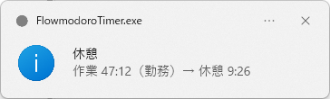
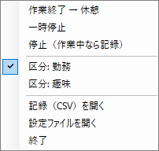
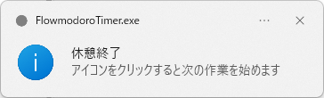

# Flowmodoro Timer

Windows のタスクトレイに常駐する、小さな**フローモドーロ**タイマーです。
集中が続くあいだ作業し、終えたら「作業時間 ÷ 5」だけ休憩します。作業ごとの記録は CSV に残るので、そのまま稼働時間の記録として使えます。

*A tiny Flowmodoro timer for the Windows system tray. Work as long as you stay focused, then rest for 1/5 of that time. Every session is appended to a CSV file. The UI is in Japanese.*



## 特長

- **トレイに常駐**し、アイコンの色で今の状態が分かる
- アイコンを**クリックするだけ**で「作業開始 → 休憩 → 次の作業」を切り替えられる
- 休憩時間を自動で計算し、**休憩が終わると通知**する
- 一時停止・再開ができる（食事などの中断は作業時間に入らない）
- 「勤務」「趣味」などの**区分**ごとに記録できる（区分の名前は自由に変えられる）
- **CSV に1行ずつ追記**するので、Excel で集計できる
- ショートカットキーを設定できる（初期状態ではオフ）
- exe ファイル1つで動き、インストールは要らない

## ダウンロードと起動

1. [Releases](../../releases/latest) から `FlowmodoroTimer.exe` をダウンロードし、好きなフォルダに置きます
   - 設定ファイルと記録はこの exe と同じフォルダに作られるので、書き込みできるフォルダに置いてください
2. ダブルクリックで起動すると、タスクトレイに丸いアイコンが出ます
   - アイコンが `^`（隠れているインジケーター）の中にある場合は、タスクバーにドラッグしておくと色が見やすくなります

> 署名のない exe なので、初めて起動すると「Windows によって PC が保護されました」と表示されることがあります。
> その場合は「詳細情報」→「実行」を押してください。不安な場合は、下の「ソースからビルド」の手順で自分でビルドできます。

**動作環境**: Windows 10 / 11（.NET Framework 4.x は Windows に最初から入っています）

### Windows の起動時に自動で起動する

`Win + R` で `shell:startup` を開き、`FlowmodoroTimer.exe` のショートカットをそこに置きます。

## 使い方

### アイコンの色


### 操作

| やりたいこと | 操作 |
|---|---|
| 作業を始める / 作業を終えて休憩に入る | トレイアイコンを**左クリック** |
| 一時停止 / 再開 | 右クリック →「一時停止」 |
| 区分を切り替える | 右クリック →「区分: …」 |
| 作業をやめる（作業中なら記録してから止める） | 右クリック →「停止」 |



- アイコンにマウスを乗せると、状態・経過時間・区分と、**今日その区分で作業した合計時間**が出ます
- 休憩中にクリックすると、休憩を切り上げて次の作業を始めます
- 休憩が終わると、通知と音でお知らせして「停止」に戻ります



## 記録（log.csv）

exe と同じフォルダの `log.csv` に、作業1回ごとに1行ずつ追記します。文字コードは BOM 付き UTF-8 なので、Excel でそのまま開けます。

```csv
日付,開始,終了,作業分,中断分,休憩分,区分
2026-11-18,13:02:10,13:50:41,46.5,2.0,9.3,勤務
2026-11-18,20:15:03,20:58:30,43.5,0.0,8.7,趣味
```

| 列 | 内容 |
|---|---|
| 作業分 | 一時停止していた時間を除いた作業時間（分） |
| 中断分 | 作業中に一時停止していた時間（分） |
| 休憩分 | 計算上の休憩時間（作業分 ÷ ratio）。休憩を早めに切り上げても変わりません |
| 区分 | 作業を終えた時点の区分 |

**作業を終えた時点**で書き込むので、休憩中に PC を落としても作業の記録は残ります。作業中にアプリを終了したときや、PC をシャットダウン・サインアウトしたときも、そこまでの作業を記録します。

## 設定（settings.ini）

初めて起動したときに、exe と同じフォルダに作られます。右クリック →「設定ファイルを開く」で編集し、**アプリを再起動すると反映されます**。

```ini
; ショートカットキー（空欄ならオフ）
hotkey=Ctrl+Alt+F
pause_hotkey=Ctrl+Alt+P
category_hotkey=Ctrl+Alt+G
; 休憩 = 作業時間 ÷ ratio
ratio=5
; 記録先（相対パスは exe と同じフォルダ）
csv=log.csv
; 区分（カンマ区切り。先頭が起動時の区分）
categories=勤務,趣味
```

| キー | 内容 | 初期値 |
|---|---|---|
| `hotkey` | 作業開始 → 休憩 → 次の作業 の切り替え | 空欄（オフ） |
| `pause_hotkey` | 一時停止 / 再開 | 空欄（オフ） |
| `category_hotkey` | 区分を順番に切り替える | 空欄（オフ） |
| `ratio` | 休憩 = 作業時間 ÷ この値 | `5` |
| `csv` | 記録ファイルの場所 | `log.csv` |
| `categories` | 区分の一覧（カンマ区切り、3つ以上も可） | `勤務,趣味` |

- ショートカットは `Ctrl` / `Alt` / `Shift` / `Win` と、キーの名前を `+` でつないで書きます（例: `Ctrl+Alt+F`、`Ctrl+Shift+F12`）
- 他のアプリと重なって登録できなかったときは、起動時に通知が出ます

## フローモドーロとは

ポモドーロ・テクニックの「25分作業・5分休憩」のように時間を固定せず、**集中が切れるまで作業し、作業時間に比例した休憩を取る**方法です。休憩はよく作業時間の 1/5 にします（50分作業したら10分休憩）。

## ソースからビルド

ソースは C# のファイル1つ（`FlowmodoroTimer.cs`）です。Windows に最初から入っている .NET Framework のコンパイラでビルドできるので、Visual Studio や .NET SDK は要りません。

```bat
build.bat
```

同じフォルダに `FlowmodoroTimer.exe` ができます。

## ライセンス

[MIT License](LICENSE)
